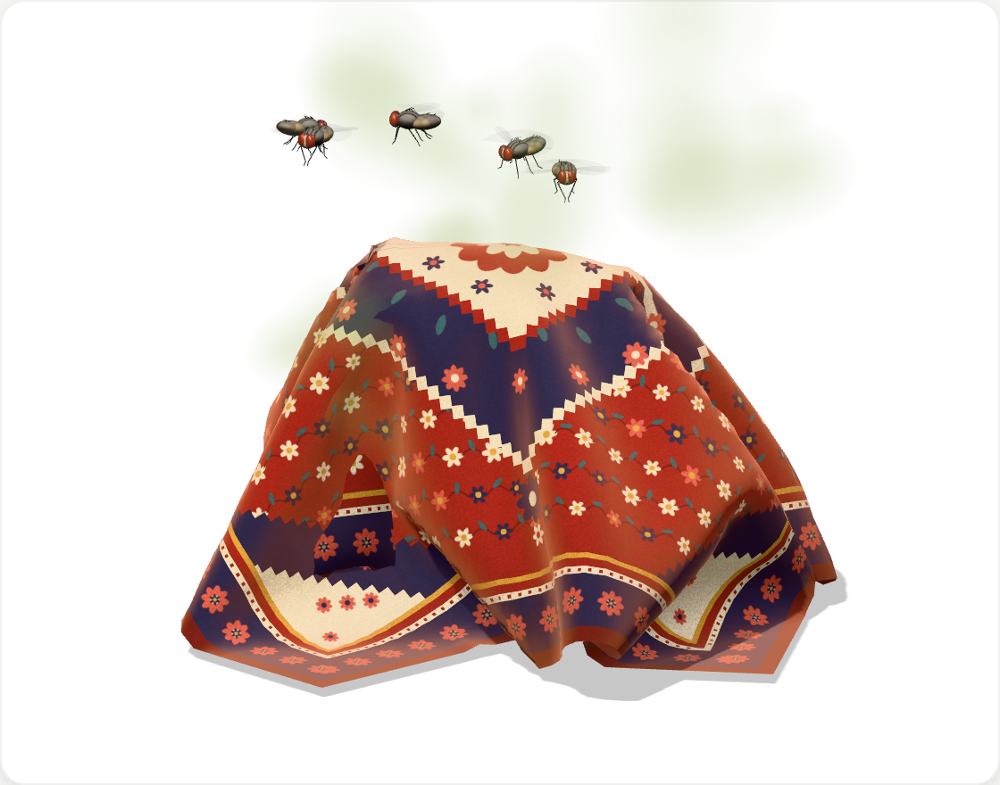
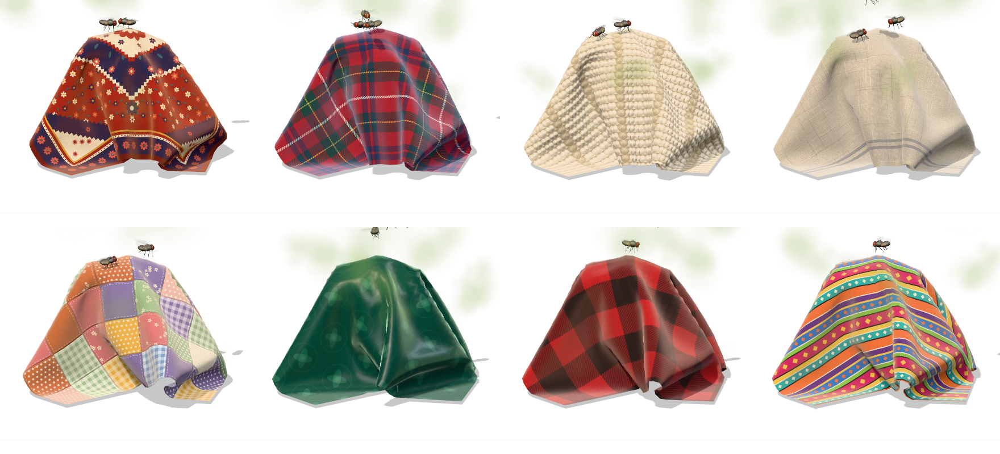

<p align="center">
  
</p>

<h1 align="center">Blanket Bin</h1>

<p align="center">
  When your Trash gets messy, Blanket Bin throws a blanket over it.<br />
  A cozy, real-time cloth simulation draped over the Trash in your Dock.
</p>

<p align="center">
  <a href="https://github.com/Beingmani/BlanketBin-releases/releases"><strong>Download for Mac</strong></a> ·
  <a href="https://github.com/Beingmani/BlanketBin-releases/releases">All releases</a> ·
  <a href="https://github.com/Beingmani/BlanketBin-releases/issues/new/choose">Report a bug</a>
</p>

<p align="center">
  
</p>

---

## What it does

Blanket Bin sits in your menu bar and keeps an eye on the Trash. Once the Trash passes a limit you choose, a blanket drops onto the Trash icon in your Dock, drapes over it and settles into folds.

- **It grows with the mess.** The fuller the Trash, the bigger and lumpier the blanket. Every file you delete makes a lump pop up and the blanket jump.
- **It gets smelly.** A faint smell seeps out from under the blanket, and houseflies arrive. They loop around the bin, land on the blanket, walk about and clean their wings.
- **It reacts to you.** Point at the Trash and a corner lifts while the flies scatter. Drag the blanket anywhere, then let go above the Trash and it drapes back over it.
- **It goes away when you clean up.** Empty the Trash and the blanket gets pulled off.

The cloth is simulated, not animated, so it falls, slides and folds differently every time. Once it settles, it stops using your CPU.

## Eight fabrics

<p align="center">
  
</p>

Top row: Persian rug, wool tartan, chunky knit, stonewashed linen. Bottom row: patchwork quilt, emerald silk, buffalo-check flannel, striped serape. Each fabric hangs its own way: silk floats down in fine folds, and a quilt drops heavy and stiff.

## Install

1. Download the latest **Blanket Bin `.dmg`** from [Releases](https://github.com/Beingmani/BlanketBin-releases/releases).
2. Open it and drag **Blanket Bin** into **Applications**.
3. Open Blanket Bin. Its icon appears in the menu bar, not in the Dock.

If macOS says the app "is damaged and can't be opened", the build isn't notarized by Apple yet. The app is fine. Open **Terminal**, run this command, and open the app again:

```bash
xattr -cr "/Applications/Blanket Bin.app"
```

Copy the whole line, including the closing `"`. If Terminal shows `dquote>`, the quote got lost: press **Control-C** and paste it again. You can also type `xattr -cr ` (with a space at the end), drag **Blanket Bin** from Applications into the Terminal window, and press Return.

**Requires** macOS 13 Ventura or later. It runs natively on Apple Silicon and Intel Macs.

## Permissions

Blanket Bin needs two permissions. Until you grant them, the menu bar panel shows a notice with a button that opens the right page in **System Settings → Privacy & Security**.

| Permission | Why it needs it |
|---|---|
| **Accessibility** | Finds where the Trash icon is in your Dock, so the blanket lands on it |
| **Full Disk Access** | Measures how big your Trash is. Without it, Blanket Bin counts items instead |

Blanket Bin also asks once to control **Finder**, so it can open and empty the Trash for you.

Blanket Bin never reads, uploads or deletes your files. It only measures the size of the Trash, and it collects no analytics.

## Using it

- **Click the menu bar icon** to open the panel: the blanket, how full the Trash is, and Open Trash, Put Blanket Back and Empty Trash.
- **Right-click the menu bar icon** for quick actions.
- **Drag the blanket** around the Dock. **Right-click it** and it floats back over the Trash.
- **Click the blanket** to open the Trash, like clicking the icon underneath.

## Settings

- **Fabric:** pick any of the eight blankets.
- **Cover the Trash at:** a size (100 MB to 10 GB) or a number of items, with iCloud Drive included if you like.
- **Switches:** cover the Trash in the Dock, let me move the blanket, flies and smell, fabric sounds, open at login.

## Updates

Blanket Bin checks for new versions and tells you in the menu bar panel when one is out. Download it from [Releases](https://github.com/Beingmani/BlanketBin-releases/releases) and drag it into Applications. Your settings stay.

## Questions

**Does it delete anything?** No. Blanket Bin only empties the Trash when you click Empty Trash and confirm it.

**Does it slow my Mac down?** The blanket stops simulating as soon as it settles. Flies keep moving at a low frame rate, and you can turn them off in Settings.

**The blanket isn't on the Trash.** Check that Accessibility is on for Blanket Bin in System Settings → Privacy & Security. If it still misses, [report it](https://github.com/Beingmani/BlanketBin-releases/issues/new/choose) with a screenshot of your Dock.

**How do I uninstall it?** Quit it from the menu bar icon and drag **Blanket Bin** from Applications to the Trash. Then it gets a blanket too.

## Feedback

Found a bug or have an idea? [Open an issue](https://github.com/Beingmani/BlanketBin-releases/issues/new/choose) and include your Blanket Bin and macOS versions.

<p align="center">
  <sub>Made by <a href="https://github.com/Beingmani">BeingMani</a></sub>
</p>
